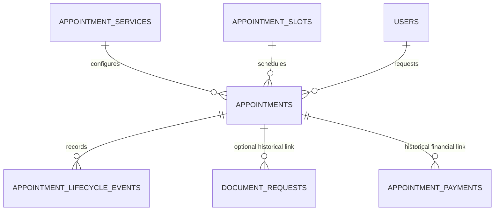

# Capstone addendum: independent appointments and document requests

Status: implementation evidence and proposed documentation update. This addendum records software behavior; it does not assert institutional approval, user evaluation, or production readiness.

## Business processes

### Registrar consultation

Student or alumni selects an active service and open slot, enters a concern, and submits a free appointment request. The default General Registrar Consultation / Advising service requires Registrar confirmation. Staff can confirm, reject with a reason, check in, complete, mark no-show after the scheduled end, and retain private staff remarks. The requester can reschedule or cancel an eligible upcoming request. Service eligibility and auto-confirm behavior are configurable by authorized Registrar staff. Applicants are eligible only when explicitly added to a service.

### Document request

Eligible requester submits documents without selecting an appointment. Registrar assesses requirements and applicable fee; payment is verified when required; the document is prepared, marked ready, and released through the existing walk-in process. Appointment capacity is not consumed. Historical appointment and payment bundle links remain available for reconciliation.

## Functional requirements

| ID | Requirement | Verification |
| --- | --- | --- |
| WF-01 | Configure service name, instructions, eligibility, activation, and approval requirement; retain services referenced by history. | `AppointmentServiceWorkflowTest::test_registrar_can_configure_examples_without_deleting_history` |
| WF-02 | Enforce service eligibility and active state on the server. | `AppointmentServiceWorkflowTest::test_service_eligibility_and_active_state_are_enforced_on_the_server` |
| WF-03 | Book free consultation appointments using shared slot availability and lifecycle controls. | `AppointmentServiceWorkflowTest::test_default_service_is_student_alumni_only_pending_and_free` |
| WF-04 | Do not create a document request or payment record for consultation booking. | Same test as WF-03 |
| WF-05 | Support confirmation, rejection, rescheduling, cancellation, check-in, completion, no-show, and private staff remarks with lifecycle identity. | Remaining tests in `AppointmentServiceWorkflowTest` |
| WF-06 | Keep new document submission independent of appointments and preserve existing assessment, pricing, payment, verification, and release restrictions. | Existing `AppointmentFreeSubmissionTest`, document submission and walk-in release tests |
| WF-07 | Preserve historical document appointment and payment records as read-only in appointment operations; continue financial reconciliation in the Cashier workspace. | `AppointmentEditingSafetyTest` and document payment tracking tests (broader suite currently has unresolved failures) |
| WF-08 | Report consultation counts by configured service, lifecycle status, and optional appointment date range. | Registrar consultation summary in appointments workspace; automated report-specific coverage remains to be added. |

## Roles and permissions

- Student and alumni: book the default service; view and manage their own eligible consultation appointments; access only their own document and payment records.
- New applicant: appointment page is reachable, but a service is unavailable unless Registrar configuration grants the role. Document permissions remain governed by existing document rules.
- Registrar/Admin: configure services and manage consultation lifecycle; historical document appointment records are read-only in the appointment workspace.
- Cashier: existing document payment reconciliation remains in the Cashier workspace; consultation has no payment actions.

## ERD changes

`appointment_service_id` is nullable so historical document appointments remain identifiable without silently converting them. Document submission may have no `appointment_id`; historical document/payment foreign keys remain for compatibility. Service-linked appointment records carry a unique reference and actor/timestamp fields for confirmation and check-in; lifecycle events retain the transition history.

## Functional and integration test cases

1. Seed defaults: exactly one active service, student/alumni eligible, approval required; examples inactive.
2. Reject inactive service and unconfigured role on booking; create no appointment.
3. Book an eligible consultation and assert no document request or payment row.
4. Confirm, reschedule, reject, cancel, check in, complete, add private staff remarks, and mark no-show only after the slot ends.
5. Submit a document request without a slot and complete its existing assessment/payment/release path.
6. Release a ready document by walk-in without creating an appointment.
7. Verify historical payment amount, receipt, proof, timestamps, and record identities remain unchanged during appointment history access.
8. Compete for the last slot using independent MySQL workers and prove workers wait on the slot lock; exactly one booking is accepted.

The consultation workflow tests cover cases 1–4. Existing tests cover document independence and historical reconciliation, but the combined run has unresolved failures. Existing slot concurrency coverage proves locking for its legacy submission path, not for consultation booking.

## UAT scenarios

- As a student, request a General Registrar Consultation, see it pending, then see the confirmed time/reference after Registrar action.
- As an alumnus, book an eligible slot and reschedule or cancel within the allowed lifecycle.
- As an applicant, verify no service is offered until Registrar enables applicant eligibility.
- As Registrar, configure a service, confirm/reject requests, check in, complete, record a no-show after the scheduled end, and review date-range service/status counts.
- As a student/alumnus, submit a document request without visiting appointment pages; follow assessment and payment instructions and collect a ready request by walk-in.
- As Registrar/Cashier, find historical appointment-linked documents and bundles in their designated workspaces and confirm existing payment evidence is unchanged.

UAT outcomes must be collected from actual participants; none are claimed here.

## Chapter 4 implementation evidence

Evidence available in source: additive migration and seeded catalog, service configuration page/controller, consultation booking and lifecycle controller actions, role-filtered portal UI, Registrar status/date summary, preserved standalone document services, and automated workflow tests. Recorded test output is in `docs/independent-appointments-document-requests-audit.md`. Screenshots, stakeholder sign-off, production deployment evidence, and UAT results remain to be collected.
