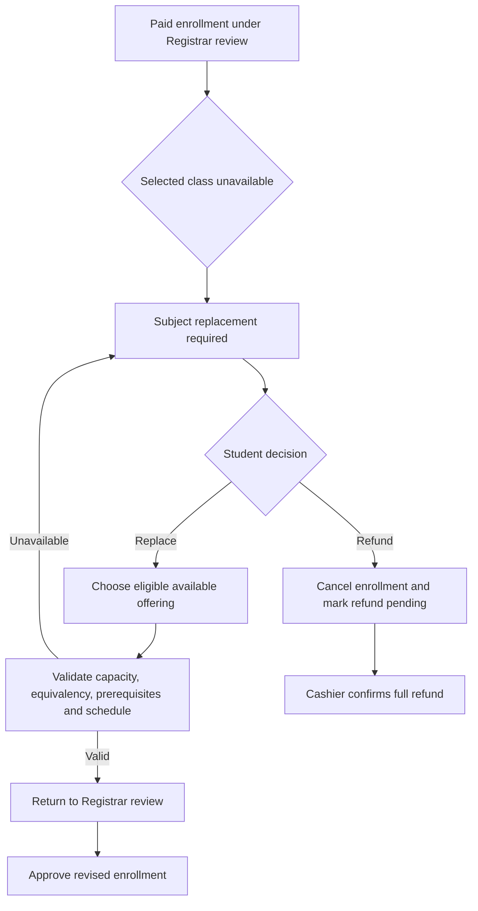

# Paid enrollment subject replacement and refund plan

## Goal

When the Registrar finds that a class in a paid enrollment is already full, the student can either replace that class or request a full refund. A replacement keeps the verified payment attached to the existing enrollment and sends the revised load back to the Registrar. A refund follows the existing Cashier confirmation and audit process.

The student's admitted degree program remains unchanged throughout this workflow. An available minor or general education class hosted by another program is treated as a cross-program class offering. A formal change of degree program remains a separate Registrar process.

## Business rules

### Subject classification

Each curriculum subject is classified as one of the following:

- **Major:** belongs to the student's degree curriculum and normally requires an offering for that program.
- **Minor or general education:** may be delivered through a class hosted by another program when the academic subject is the same or has an approved equivalency.

The subject name or a similar course code alone does not establish equivalency. The Registrar must maintain an explicit equivalency record before the system offers a different curriculum subject as a replacement.

### Allowed replacements

| Unavailable selection | Allowed replacement | Approval rule |
| --- | --- | --- |
| Minor/general education | Another available section of the same subject | Automatically eligible |
| Minor/general education | Approved equivalent hosted by another program | Registrar-approved equivalency required |
| Major | Another available section of the same subject | Automatically eligible |
| Major | Approved equivalent subject | Explicit Registrar approval required for this replacement |
| Any subject | Subject with no approved equivalency | Ineligible |

Every replacement must also pass the normal unit, prerequisite, schedule-conflict, academic-term, and capacity checks. Cross-program selection changes the class offering only. The enrollment's `program_id` stays fixed.

### Irregular enrollment

- Moving to another section of the same subject in the student's original program does not by itself change Regular/Irregular status.
- Moving a minor/general education subject to another program's section is marked Irregular only when the approved academic mapping explicitly records that requirement.
- A major subject's transfer to another section of the same course is not automatically Irregular.
- A major replacement by an equivalent subject in another program requires an official, directed equivalency approval. Its approved load treatment is recorded with that approval.

`is_irregular` remains a property of the enrollment for the current academic term. It is not a user role or a permanent student classification. Replacement history preserves the baseline load classification, so a later revision can remove a policy-triggered Irregular designation without clearing a pre-existing Irregular load.

### Payment

- Choosing a replacement preserves the verified payment, receipt, and payment audit history.
- No second payment is collected when the enrollment fee is unchanged.
- Choosing a refund marks every verified payment for the enrollment as `refund_status = pending`.
- The Cashier confirms the full refund using the existing amount and reference controls.
- A pending refund continues to block another payment for the same academic term.
- If enrollment fees later depend on units, the replacement workflow must calculate an additional balance or refund before final approval.

## Workflow

1. The Cashier verifies the payment and the enrollment reaches Registrar review.
2. The Registrar identifies the unavailable class and selects **Request subject replacement**.
3. The Registrar records a student-facing reason and may limit the eligible replacement offerings.
4. An open revision request marks the enrollment as subject-replacement-required without adding an enrollment status value. Its payment remains verified and no refund is opened.
5. The student chooses one of two actions:
   - **Replace subject:** select one eligible offering and resubmit the existing enrollment.
   - **Request full refund:** cancel the enrollment and start refund follow-up.
6. A replacement is checked again inside a database transaction for capacity, equivalency, schedule conflicts, term, and enrollment ownership.
7. Successful resubmission returns the enrollment to `pending` for Registrar review. The system recalculates `is_irregular` from the preserved baseline and the approved replacement rules.
8. The Registrar approves the revised enrollment, or requests another replacement if the selected offering became unavailable.
9. A refund request moves the enrollment to the existing `rejected` non-active state and its verified payment to `refund_status = pending`. The request record distinguishes a student-requested refund from Registrar rejection. The Cashier records the full refund using the existing reconciliation flow.

## Statuses and actions

| Enrollment status | Meaning | Available actions |
| --- | --- | --- |
| `pending` | Awaiting payment verification or Registrar decision under the existing flow | Verify payment, approve, reject, or request subject replacement |
| `pending` + open replacement request | Paid enrollment returned for one or more unavailable classes | Replace eligible section or request refund |
| `approved` | Final registered load | View or download COR |
| `rejected` | Registrar denied the enrollment for a reason that cannot be corrected through this workflow | Existing paid-rejection refund follow-up |
| `rejected` + refund-requested revision record | Student chose refund instead of replacement | Cashier refund confirmation |

The Registrar's general **Reject** action remains available for non-correctable enrollment problems. A full class uses **Request subject replacement**, giving the student both resolution choices.

## Data model changes

### Class offerings and capacity

Capacity belongs to a scheduled offering rather than the curriculum subject. The additive migration extends `class_schedules` with:

- `section_code`
- `hosting_program_id` (separate from the curriculum subject's owning program)
- `school_year`
- `semester`
- `capacity`
- `is_active`
- `requires_irregular` for cross-program sections

Allow multiple offerings for one `course_subject_id`. A same-subject section hosted by another program keeps the original academic subject identity and curriculum mapping. Only an explicitly configured, active offering for the enrollment's exact term with a positive capacity can be selected. Cross-program offerings additionally require an explicit Regular/Irregular policy. An offering's occupied seats are counted from active enrollment selections in `pending` and `approved` enrollments. Historical enrollments from other terms do not count against current offerings. If active enrollments in the same term have no recorded section assignment for a candidate subject, the system does not guess an assignment or subtract them from every section; it blocks new section selection and capacity reductions until the Registrar reconciles those records. Unpaid enrollment records remain included in this reconciliation because the existing workflow has no seat-reservation policy.

### Enrollment offering assignments

Add `enrollment_subject_offerings` for the section assignments created by this workflow:

- `enrollment_id`
- `curriculum_subject_id`
- `class_schedule_id`
- timestamps

The canonical curriculum selection remains in `enrollments.subject_ids`. The new assignment maps a curriculum subject to its actual offered section, keeping the degree program and curriculum identity unchanged. Historical section assignments are not backfilled because the old schema does not record enough information to identify them safely.

### Classification and equivalency

Add `classification` to `course_subjects` with values `major`, `minor`, and `general_education`. Pre-existing subjects migrate as `unclassified` rather than guessing their academic category.

Add `course_subject_equivalencies` with:

- directed source and equivalent subject IDs
- approving user and timestamp
- academic reason
- explicit `requires_irregular` decision

Equivalencies are directed and immutable after approval; a reverse equivalency must be separately recorded. Different subjects are never considered equivalent based only on title, code, or units. A replacement must have matching units until a credit-adjustment policy is defined.

### Replacement request audit

Add `enrollment_replacement_requests` and `enrollment_replacement_items` with:

- enrollment, Registrar actor, reason, state, student refund reason, submission/resolution timestamps
- each affected curriculum subject
- optional known unavailable section
- chosen section and equivalency, recorded when the student resubmits

Repeated revisions create new request records. This preserves the original and revised choices without replacing `subject_ids` or editing approved enrollment history.

## Interface changes

### Registrar review

Add **Request subject replacement** beside Approve and Reject. The form requires:

- the unavailable enrolled subject and class offering
- a clear student-facing reason
- optional restrictions to approved replacement offerings

The review screen shows classification, schedules, and reported section capacity. The Registrar can record a directed equivalency with an academic reason and an explicit Regular/Irregular treatment before returning the enrollment. The affected section is recorded when known.

### Student enrollment status

Show a focused action card containing:

- the unavailable subject and Registrar's reason
- the current verified-payment status
- eligible alternatives with program host, section, schedule, remaining seats, and units
- **Replace subject and resubmit** and **Request full refund** actions

The degree program is never changed. The page explains that a same-subject section transfer does not itself change load classification and that approved equivalencies use their recorded treatment. The refund action requires the student's reason and explicit confirmation.

### Cashier

The existing refund queue includes student-requested refund follow-up alongside paid Registrar rejections. It continues to require the exact full amount and a refund reference. Replacement-only requests do not appear in the refund queue.

### Certificate of Registration

The COR uses the final class offering and displays the host program or section when a minor/general education class is delivered through another program. The student's admitted program remains the program shown in the enrollment heading.

## Transaction and concurrency requirements

- Lock the enrollment, replacement request, selected offering, and relevant payment rows when a replacement or refund is submitted.
- Recount occupied seats while holding the offering lock. A seat displayed earlier is not guaranteed until resubmission succeeds.
- Refuse changes after the enrollment has been approved, cancelled, or refunded.
- Reject the recorded unavailable section on submission as well as excluding it from the displayed choices.
- Ensure the selected replacement remains eligible for the original unavailable subject.
- Replace only the subject named in the open replacement request; preserve every other enrollment selection.
- Make resubmission and refund actions idempotent so repeated browser submissions cannot duplicate selections or refund requests.
- Keep verified receipts immutable and retain all original payment records.

## Notifications

- **Student:** subject replacement required, including the unavailable subject and deadline if the institution configures one.
- **Registrar:** revised enrollment resubmitted.
- **Cashier:** refund follow-up requested only after the student selects refund.
- **Student:** revised enrollment approved, replacement became unavailable, or full refund confirmed.

Notifications link to the exact enrollment or payment record and use event-specific deduplication keys.

## Implementation order

1. Add safe subject classification, directed equivalency approvals, term-specific section offerings, assignments, and revision history.
2. Keep `subject_ids` as the curriculum source of truth; do not guess historical section assignments.
3. Add Registrar actions and eligible-alternative calculation.
4. Add student replacement/refund actions with transactional capacity checks.
5. Reuse the existing Cashier refund queue and full-refund confirmation for student-requested refunds.
6. Update notifications, dashboards, payment history state, and COR rendering.

## Acceptance criteria

- A paid enrollment with a full class can be returned without opening a refund or invalidating its verified payment.
- The student can replace only the class identified by the Registrar.
- A minor/general education class can use an available offering hosted by another program when it is the same subject or an approved equivalent.
- A major replacement requires the same subject or explicit Registrar-approved equivalency.
- Cross-program class selection never changes `enrollments.program_id`.
- Irregular status is set consistently from the final subject load.
- Later revisions retain Irregular treatment required by unaffected section assignments or equivalencies. Classification is recalculated from all current assignments plus the preserved baseline, so removing the last policy-triggered Irregular assignment can still restore a Regular baseline.
- Capacity cannot be exceeded when two students attempt to claim the final seat concurrently.
- Schedule conflicts, wrong-term offerings, unapproved equivalencies, duplicate subjects, and invalid ownership are rejected server-side.
- Resubmission requires no additional payment while the original verified payment remains valid.
- Choosing a refund moves the enrollment to the existing rejected state, creates one pending refund follow-up, and blocks another term payment until the Cashier confirms the full refund.
- The COR, dashboards, notifications, payment history, and Registrar/Cashier queues show the final state consistently.
- The audit trail identifies the unavailable selection, replacement, requesting Registrar, approving Registrar when required, payment state, and refund confirmation.

## Required tests

- Minor subject moved to another section of the same subject.
- Minor subject replaced by an approved cross-program equivalent.
- Unapproved cross-program subject rejected.
- Major subject moved to another section.
- Major equivalent accepted only with explicit approval.
- Full offering rejected during resubmission, including a concurrent last-seat test.
- Schedule conflict, prerequisite failure, duplicate selection, wrong term, and foreign enrollment rejected.
- Verified payment preserved through one or repeated replacement cycles.
- Student refund choice creates one pending refund and Cashier can confirm only the exact full amount.
- Approved, cancelled, refunded, and another student's enrollments cannot be modified.
- Existing paid Registrar rejection and refund reconciliation tests continue to pass.
- Final COR and transaction history show the replacement and payment/refund state correctly.

## Current implementation boundaries

- See `docs/enrollment-workflow-acceptance.md` for the follow-up implementation map, specification conflicts, verification commands and per-role manual checklist. Student revision now requires an explicit reviewed confirmation. Concurrent resubmissions use a current locking seat count and bounded deadlock retries; a replacement cannot duplicate an unaffected subject in the final load.
- The existing enrollment schema has no prerequisite graph or configured maximum unit load. Those rules cannot be safely invented; prerequisites and load limits remain Registrar policy checks until represented in the system.
- Replacement choices require a section code, current-term match, active status, positive capacity, sufficient remaining seats, and a valid directed equivalency when the offered course subject differs from the curriculum subject. Equivalent subjects must have matching units. A section for the same curriculum subject can be hosted by a different program without changing that subject identity. The cross-program offering must explicitly record its Regular/Irregular treatment.
- Existing enrollments have no section identity. Historical terms are excluded from current offering capacity. Same-term active enrollments with unknown section assignments block selection and capacity reductions until manually reconciled; they are not assigned to or independently subtracted from every section.
- A refund request reuses the existing `rejected` enrollment status for compatibility. Student-specific reason and lifecycle are separately retained in the revision request; the verified payment remains verified and only its refund status changes.
- The current Cashier workflow supports manual reconciliation of an exact full refund with an external reference. It does not issue GCash refunds, perform partial refunds, or offer deferral/reduced-load workflows. A different refund policy requires an explicit institutional decision and configuration.
- Pre-existing subjects migrate as `unclassified`; an admin must classify each subject before it can participate in an equivalency approval. Equivalencies are directional and require an explicit load-treatment decision.
- The migration intentionally does not backfill offerings or section assignments because historical data does not identify a reliable section.
